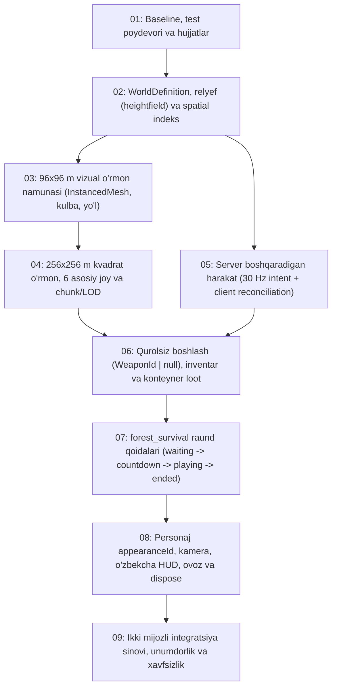

# Bosqichma-bosqich amalga oshirish rejasi (IMPLEMENTATION_PLAN)

Ushbu hujjat `01` bosqichda mavjud kod bazasini (`TypeScript` + `Three.js` + `Socket.IO`) auditdan o‘tkazish asosida tuzildi va `02–09` bosqichlarning texnik vazifalari, modul bog‘liqliklari hamda regressiya chegaralarini belgilaydi.

> **Qoida:** Eski `tdm` va `ffa` rejimlari hamda Dust Arena (`buildDustArena`) adapterning bir qismi sifatida ishlashda davom etadi; yangi `forest_survival` rejimi va kvadrat o‘rmon xaritasi alohida modulli arxitektura orqali qo‘shiladi.

---

## 1. Joriy holat (01 Baseline) xulosasi

- **Xarita (`src/shared/map.ts`):** Bitta global `MAP = buildDustArena()` (`100 × 70` m, `104` ta AABB quti, `39` ta spawn).
- **Render (`src/client/game/World.ts`):** `MAP.boxes` dan to‘g‘ridan-to‘g‘ri `BoxGeometry` chizadi; `135` ta halqa daraxtidan `132` tasi `MAP.bounds` tashqarisida (`+2` ta burchak daraxti ichkarida).
- **Fizika (`src/shared/physics.ts`):** Tekis yer va AABB qutilar ro‘yxati bo‘ylab chiziqli qidiruv (`O(N)`); heightfield relyef va spatial indeks yo‘q.
- **Harakat va tarmoq (`src/server/room.ts`):** `onState()` mijoz yuborgan `(x, y, z)` ni faqat `MAP.bounds` ga qisadi (`clamp`); serverda harakat simulyatsiyasi va devor tekshiruvi yo‘q.
- **Loadout va buyumlar (`src/shared/weapons.ts`, `LocalPlayer.ts`, `room.ts`, `Effects.ts`):** `fullAmmo()` barcha 4 qurolni to‘la o‘q bilan beradi, `weapon: WeaponId` (`null` bo‘la olmaydi). `Effects.dropWeapon()` faqat `6.5` soniyalik mijoz vizual effekti.
- **Raund (`src/server/room.ts`):** Faqat `tdm` va `ffa`, `phase: 'playing' | 'ended'`, `RESPAWN_TIME = 3` soniya.

---

## 2. Bosqichlar (02–09) va modul bog‘liqliklari

---

### Bosqich 02 — Umumiy dunyo modeli, relyef va to‘qnashuvlar
- **O‘zgaradigan / yangi modullar:**
  - `src/shared/map.ts` (yoki yangi `src/shared/world.ts`, `src/shared/terrain.ts`, `src/shared/spatial.ts`)
  - `src/shared/physics.ts`, `src/shared/protocol.ts`
  - `src/server/room.ts`, `src/server/navgraph.ts`, `src/server/bot.ts`, `src/server/index.ts`
  - `src/client/game/World.ts`, `src/client/game/LocalPlayer.ts`, `src/client/game/Game.ts`
- **Asosiy bog‘liqliklar:**
  - Global `MAP` o‘rniga xonaga (`Room`) bog‘langan `WorldDefinition` (`mapId`, `worldVersion`, `publicLayoutSeed`, `bounds`, `terrain`, `colliders`, `visuals`, `spawns`, `pois`, `containers`).
  - Deterministik `worldHash` (`WelcomeMsg` va `ready` zanjirida mijoz va server o‘rtasida solishtiriladi; maxfiy `lootSeed` mijozga yuborilmaydi).
  - Heightfield relyef (`getTerrainHeight`, `getTerrainNormal`, yurish qiyaligi) + AABB colliderlar uchun spatial grid indeksi (`physics.ts`).
  - `getNav()` keshini xarita/seed/versiyaga bog‘lash; relyefli navigatsiya tayyor bo‘lmaguncha `forest_survival` rejimida botlarni aniq o‘chirish.

---

### Bosqich 03 — Haqiqiy o‘ynaladigan vizual o‘rmon namunasi (96 × 96 m)
- **O‘zgaradigan / yangi modullar:**
  - `src/client/game/World.ts`, `src/client/game/Textures.ts`, `src/client/game/Game.ts`
  - `02` da yaratilgan shared prefab/terrain generatorlari
- **Asosiy bog‘liqliklar:**
  - `02` dagi `WorldDefinition` va `heightfield` ustiga quriladi.
  - `96 × 96` metrlik sinov sahnasi: egri tuproq yo‘l, 1 ta ichiga kiriladigan original kulba (eshik/devor/pol colliderlari bilan), 3–5 xil original daraxt silueti, buta/maysa/qoya qatlamlari.
  - `THREE.InstancedMesh` orqali daraxt, tosh va o‘simliklarni chunk/masofa bo‘yicha guruhlash, frustum culling uchun bounding sphere/box yangilash.
  - Sifat sozlamalari (`low` / `medium` / `high`).

---

### Bosqich 04 — Kvadrat o‘rmon (256 × 256 m), uylar va tashlandiq joylar
- **O‘zgaradigan / yangi modullar:**
  - Shared xarita generatori va validator (`src/shared/...`)
  - `src/client/game/World.ts`, `src/server/room.ts`, `src/server/index.ts`
- **Asosiy bog‘liqliklar:**
  - `03` da tasdiqlangan vizual uslub va `02` dagi fizika poydevoriga tayanadi.
  - `256 × 256` m o‘ynaladigan kvadrat o‘rmon (`32` m chunklar va LOD bilan), 6 ta asosiy joy (o‘rmonchi uyi, kulbalar guruhi, tashlandiq taxta ustaxonasi, eski servis binosi, lager, tosh xarobalar).
  - Bino ostini tekislash, o‘simlik ekishda yo‘l/bino/spawn/konteyner istisno niqoblari (exclusion masks).
  - `8–12` ishtirokchi uchun minimal masofa va to‘siqsizlik bo‘yicha tekshirilgan spawn nuqtalari hamda konteyner descriptorlar (stable ID bilan, lekin loot tarkibisiz).

---

### Bosqich 05 — Server boshqaradigan harakat va tarmoq holati
- **O‘zgaradigan / yangi modullar:**
  - `src/shared/protocol.ts`, `src/shared/physics.ts`, `src/shared/constants.ts`
  - `src/server/room.ts`, `src/server/lobby.ts`
  - `src/client/game/Input.ts`, `src/client/game/LocalPlayer.ts`, `src/client/game/Game.ts`
- **Asosiy bog‘liqliklar:**
  - `02` dagi umumiy fizika va relyef funksiyalarini serverda `30 Hz` qadam bilan ishlatadi.
  - Mijoz mutlaq `(x, y, z)` o‘rniga `InputIntent` (`seq`, `roundId`, harakat/qarash yo‘nalishi, tugmalar) yuboradi.
  - `Snapshot` ichida `serverTick`, `roundId`, `lastProcessedSeq` qaytadi; mijozda client-side prediction va server reconciliation ishlaydi.
  - `06` dagi masofa va ko‘rinish chizig‘i (LOS) tekshiruvlari aynan shu server pozitsiyasiga tayanadi.

---

### Bosqich 06 — Qurolsiz boshlash, inventar, konteyner va buyum olish
- **O‘zgaradigan / yangi modullar:**
  - `src/shared/weapons.ts`, `src/shared/protocol.ts`, `src/shared/constants.ts` (+ yangi `src/shared/inventory.ts`)
  - `src/server/room.ts`, `src/server/lobby.ts` (+ yangi `src/server/loot.ts`)
  - `src/client/game/LocalPlayer.ts`, `src/client/game/Game.ts`, `src/client/game/ViewModel.ts`, `src/client/game/Stickman.ts`, `src/client/game/Hud.ts`, `src/client/game/Effects.ts`
- **Asosiy bog‘liqliklar:**
  - `04` dagi konteyner descriptorlari va `05` dagi avtoritativ server pozitsiyasiga tayanadi.
  - `WeaponId | null` — qurolsiz boshlash (`forest_survival` rejimida bo‘sh inventar, 0 o‘q-dori, 0 granata; `tdm`/`ffa` da eski loadout saqlanadi).
  - 2 ta qurol sloti va o‘q-dori zaxirasi, har bir buyum uchun unikal server `itemId`.
  - `E` tugmasini bosib turish (`1 s`, `2 m`, server LOS + relyef/collider tekshiruvi) bilan konteyner ochish, `revision` va idempotent `requestId` orqali atomar buyum olish hamda yerga tushgan server entity buyumlari.

---

### Bosqich 07 — O‘rmondagi yakunlanadigan survival raundi (`forest_survival`)
- **O‘zgaradigan / yangi modullar:**
  - `src/shared/constants.ts`, `src/shared/protocol.ts`
  - `src/server/lobby.ts`, `src/server/room.ts` (+ rejim qoidalari moduli)
  - `src/client/main.ts`, `src/client/game/Game.ts`, `src/client/game/Hud.ts`, `index.html`
- **Asosiy bog‘liqliklar:**
  - `06` dagi inventar/loot tizimi bilan integratsiyalanadi.
  - `MatchState.phase`: `waiting → countdown → playing → ended`.
  - Kamida 2 tayyor ishtirokchi sharti, kech kirganlar uchun kuzatuvchi (`spectator`) rejimi, raund ichida respawn yo‘qligi, raunddan chiqqanda inventar buyumlarining bir marta dunyoga tushishi.
  - Oxirgi faol ishtirokchi g‘olib (`winnerId` + `winnerName`), bir vaqtda 0 faol qolsa yoki vaqt tugasa durang (`draw`), yangi `roundId` bilan to‘liq tozalab qayta boshlash.

---

### Bosqich 08 — Personaj, kamera, interfeys va resurslar
- **O‘zgaradigan / yangi modullar:**
  - `src/client/game/Stickman.ts`, `src/client/game/ViewModel.ts`, `src/client/game/Game.ts`, `src/client/game/Hud.ts`, `src/client/game/Audio.ts`, `src/client/game/World.ts`
  - `src/client/style.css`, `src/shared/protocol.ts`, `src/server/room.ts`
- **Asosiy bog‘liqliklar:**
  - Server bergan barqaror `appearanceId` orqali local va remote personaj ko‘rinishini birxillashtirish, qurolsiz idle/walk animatsiyalari.
  - 3P/1P kamera (`V`) relyef va bino ichki devorlari bilan to‘qnashuvi.
  - O‘zbekcha HUD holat yozuvlari (`Qurolsiz`, `Ochish`, `Ochildi`, `Bo‘sh`, `Inventar to‘la`, `Uzoqdasiz`, `Kuzatuvchi`), o‘rmon va konteyner tovushlari, `dispose()` resurs tozaligini tekshirish.

---

### Bosqich 09 — Yakuniy ikki mijozli sinov, tezlik va onlayn tayyorgarlik
- **O‘zgaradigan / yangi modullar:**
  - `src/server/index.ts`, `src/server/lobby.ts`, `src/server/room.ts`, `README.md` va integratsiya testlari
- **Asosiy bog‘liqliklar:**
  - Ikki haqiqiy brauzer mijozida barcha `02–08` talablarini (`worldHash`, qurolsiz spawn, poyga holatida konteynerdan bitta buyumni olish, LOS/masofa rad etilishi, kuzatuvchi, disconnect, raund yakuni va reset) tekshirish.
  - Frame time (o‘rtacha va p95), draw calls, triangles va `30 Hz` server tick (`<= 33.3 ms` byudjet) o‘lchovlari.
  - Tarmoq payload/rate limitlari, `PORT`/`CORS_ORIGIN` muhit o‘zgaruvchilari, chat/bot vakolatlari va production reverse-proxy (HTTPS/WSS) yo‘riqnomasi.
